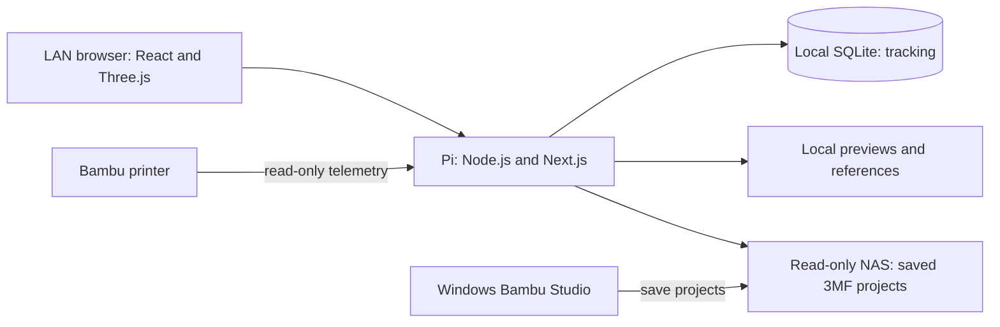
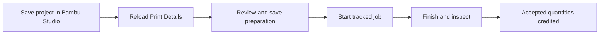

# Build Desk Pi · 1.0.0

## Application Description

Build Desk tracks workshop model builds through Printing and Purchasing, with separate completion records for fabricated components. This guide covers the Raspberry Pi deployment only. The current installation serves **Kitten 745** and **Kitten 980 Loader** at **http://192.168.0.119:4174/** on the home LAN.

A Node.js 24 server runs Next.js and React on the Pi. Tracking lives in a local SQLite database (schema 5), with independent build records and shared vendor suggestions and printer identity. Saved 3MF projects live on the read-only NAS mount; generated geometry, images and reference caches live on the Pi. Bambu Studio runs separately on Windows. The application neither slices projects nor sends prints to the printer. Excel is not required; workbook support remains for migration compatibility.



The diagram describes the source architecture, not a live connectivity check. Runtime data, credentials, designer models and generated assets are excluded from Git and require separate backups.

## User Instructions

### Select and browse a build

Open the LAN address and select a build in the header. Expand the Printing tree through sections, files, plates and parts, or search and filter by completion/readiness. Select a plate for its interactive 3D preview and membership. Select a part for quantities, references and installation progress. Click the Build Desk logo for About and version information.

Use a desktop-width browser for editing. Narrow-screen layouts and archived builds are read-only. Changes to requirements or installed quantities require an explicit save; resolve unsaved drafts before navigating. Unknown required quantities appear as quantities to confirm rather than completed work.

### Prepare, print and inspect

1. Open the same NAS project in Windows Bambu Studio. Review the designer's print face, supports, material, nozzle, enabled objects and slicing there.
2. Save the project. In Build Desk choose **Reload Print Details** from its file or plate. Review changed/new plates and any unmatched objects. A plate name ending in `ignore` excludes a custom layout from tracking.
3. Choose **Review Plate**. Set runs, material, profile, included parts, enabled copies and planned quantities, then save preparation. Enabled copies mean complete part units, which may differ from mesh count for split components. Required quantity is the total needed for the vehicle, not this plate's output.
4. Use **Start print** to record the tracked job and start the actual print separately through your normal Bambu workflow. Builds sharing a printer cannot start concurrent tracked jobs.
5. Finish the recorded job through inspection and record accepted/rejected quantities. Telemetry never credits accepted parts. Review manual reprints against their original part associations. Cancel a job when appropriate instead of recording successful production.



**Reload Tracking Data** refreshes saved tracker state; **Reload Print Details** reimports saved 3MF membership and previews. Neither action confirms print output. Fabricated components use their own completed quantity and method (Unspecified, Hand made or Outsourced), without print jobs or Purchasing stock. Installed quantity cannot exceed completed quantity.

### Purchasing

Use the searchable list and All, Not Available, Ordered or Available filters. Select a part to edit on-hand stock, Ordered, vendor, product URL, Alternate URL, order date and notes. Designer identity, description and required quantity are read-only. Save explicitly; navigation offers Save, Discard or Stay for unsaved drafts.

Ordered is an independent marker. Each toggle asks whether to update the order date; keeping the existing date preserves a blank date too. Available is calculated from sufficient on-hand stock; extra stock is allowed. Unknown requirements need review. Stock and progress are separate for each build. Vendor suggestions share names across builds, not inventory.

A dashed gray circle indicates unavailable, a green ring indicates Ordered, and solid green indicates Available. Available takes display precedence over Ordered. The overview shows available units and ordered part types. **Parts Source List** and **Parts Status** export landscape PDFs for every part in the selected build regardless of filters. Source-report product and alternate links are clickable; status groups list each part once under Not Yet Available, Ordered or Available.

Purchasing is maintained manually. There are no email, Drive, shipment or receipt integrations. Assembly is reserved and disabled.

## How to Load and Start

### Use the installed Pi

Keep the Pi running and open **http://192.168.0.119:4174/** from the home LAN. No SSH tunnel, spreadsheet application or cloud account is needed for use. If the address changes, update your bookmark and the service's allowed LAN host. The optional `node tools/open-pi.mjs --open` checks and opens that fixed Pi address (edit the launcher if it changes).

For administration, log into the Pi as `preston`:

```sh
cd /home/preston/build-desk
systemctl --user status build-desk --no-pager
curl --fail http://127.0.0.1:4174/api/health
systemctl --user restart build-desk
```

The user service uses `/home/preston/.local/node/bin/node`, the private registry `local-data/builds.pi.json`, and port 4174. Read `local-data/service.log` and `local-data/service.err.log` if startup fails. Boot startup requires the enabled user unit, `Linger=yes`, and the NAS automount; confirm with `loginctl show-user preston -p Linger`. A physical reboot acceptance check is still outstanding in the deployment record.

### Install or recover a Pi

Use 64-bit Linux ARM64 and **Node.js 24**, including `node:sqlite`. Install Git and Python 3 for offline import/maintenance tools. The established target is a Pi 3 B+; build memory is limited. Install dependencies on Linux ARM64 rather than copying Windows dependencies or build output.

Authenticate the private repository with your own account. The deployed application line is `Refinement_v2`; choose a reviewed commit from that line, including the 1.0.0 housekeeping update, rather than assuming `main` has the same features.

```sh
git clone --branch Refinement_v2 https://github.com/sbirdranch/build-desk-pi.git "$HOME/build-desk"
cd "$HOME/build-desk"
npm ci --ignore-scripts
npm --prefix web ci --ignore-scripts
npm test
npm --prefix web run typecheck
npm run app:build
mkdir -p local-data assets/generated
cp config/builds.pi.example.json local-data/builds.pi.json
```

The example is configuration only: it creates no database, builds or assets. Restore a consistent schema-5 database, its matching registry and asset directories from backup, or complete the offline import process below. Edit the private registry to point to those actual paths and build IDs. Do not start against an empty placeholder or copy the tracked legacy `config/builds.json` as production configuration.

Mount the NAS read-only at `/mnt/builddesk` and verify the service user can read every configured project. `tools/configure-pi-nas.sh` and `deploy/nas/` provide the existing mount setup; enter credentials locally and keep them outside Git. Use the user-service template for the established installation:

```sh
mkdir -p "$HOME/.config/systemd/user"
cp deploy/build-desk-user.service "$HOME/.config/systemd/user/build-desk.service"
systemctl --user daemon-reload
systemctl --user enable --now build-desk
curl --fail http://127.0.0.1:4174/api/health
```

Review paths, Node location, LAN settings and NAS readiness before enabling it. An administrator can run `sudo loginctl enable-linger "$USER"` for startup without login. The template expects `$HOME/build-desk` and `$HOME/.local/node/bin/node`. The installed unit also has a NAS pre-start check; retain that when replacing a unit. `deploy/build-desk.service` is a separate `/opt/build-desk` system-service alternative, not the current installation. Run one production writer and one service supervisor only.

## Documentation for Adding a New Model

There is no general-purpose model-import wizard. Adding a vehicle is an offline, reviewed data preparation and registration task. Reimporting one saved project with Reload Print Details does not create a new vehicle.

1. Inventory the actual designer package: manuals, BOM, STL/STEP/DXF, references and variants. Choose a new URL-safe build ID and confirm the requested vehicle/attachments. Keep designer sources unchanged. Record file hashes and attribution.
2. Separate printed components, custom fabricated parts and purchased hardware. Record unknown/conflicting quantities explicitly. Saved mesh instances do not establish assembly requirements; do not reuse another build's stock, accepted quantities, jobs, preparations or notes.
3. Prepare independent review 3MFs and assets. Preserve designer geometry and print faces; bed-plane rotation and placement require review. Native reopen/export checks must verify material/profile and plate/object membership. Slice and physically qualify separately in Bambu Studio.
4. Create stable build-scoped part, file, plate and assignment IDs. Match full saved source paths, especially repeated basenames. Verify preview membership against tracked membership. Keep fabricated parts out of print assignments and print results. Preserve distinct asset roots/catalogs per vehicle.
5. Register into a **new consistent database copy**, compare every existing build/global business record, and test with a private disposable registry on a loopback port such as 4178. Test both old/new builds, save/reload, restart persistence, reports, asset serving and shared-printer exclusion.
6. Back up the latest production database, registry, assets and code before a controlled service stop and cutover. Retain the prior pair. Never restore an old database over newer production edits.

The existing scripts are model-specific examples, not interchangeable import commands:

| Source | Preparation and evidence |
|---|---|
| Kitten truck | `tools/prepare-kitten-instance.py`, `config/designer/kitten-745-purchases.json`, [truck preparation](docs/builds/second-truck-import.md) |
| Kitten loader | `tools/export-loader-projects.py`, `tools/prepare-loader-data.py`, `config/designer/kitten-980-purchases.json`, [loader preparation](docs/builds/loader-import.md) |
| Database registration | `tools/register-build-instance.py` (currently **schema 4 only**; see Outstanding Issues) |
| Orientation checks | `tools/verify-project-print-faces.py` |

Those linked documents retain implementation/acceptance evidence and historical paths; validate their commands against current code before use. Do not run the old cutover scripts blindly on schema 5.

Copy and paste this prompt when asking an AI assistant to prepare a new vehicle:

```text
Inspect the current Build Desk Pi source, registry schema and model-import tools first.
Inventory the supplied designer package read-only. Ask me to choose variants and
attachments where ambiguous. Produce a source-hashed manifest separating printed,
fabricated and purchased parts, with attribution and unknown/conflicting quantities.
Preserve designer geometry and print faces. Use stable build-scoped IDs and independent
assets. Do not copy progress, stock, jobs, preparations or notes from another build.
Check the importer's schema compatibility before using it. Work in a new disposable
SQLite copy and private registry. Verify full-path object mappings, preview membership,
existing-build preservation, save/reload, restart, reports and shared-printer exclusion.
Show the manifest and validation results before proposing a production cutover.
```

## Database Setup and Model Import

Production uses registry store `{ "kind": "sqlite", "path": "local-data/build-desk.db", "schema": "build-desk-v2" }`; the filename is an example. The actual database path is chosen by the private registry, not a hard-coded filename. All current builds share that database, with build-scoped identities. `build-desk-v2` names the adapter contract; the current SQL migration version is **5**.

`web/src/server/sqlite-schema.mjs` defines the schema. The runtime refuses incompatible versions and does not perform automatic migrations. SQLite transactions enforce revisions, request replay and shared-printer start exclusion. Every save attempt first creates and verifies a consistent online backup in `backups/` beside the database; backup failure blocks writes.

For recovery, restore a known-good matching schema-5 database and registry. A blank SQL schema alone has no populated vehicle. For legacy workbook import, `web/scripts/migrate-sqlite.mjs` accepts a workbook **copy** and a new output path and emits migration/provenance reports. Inspect its result before proceeding. Subsequent acquisition/fabrication transformations are separate tools; because they reference the current schema initializer, do not assume their historical schema comments still describe their output. The current schema-4 registration helper cannot register directly into schema 5. A new import needs that compatibility gap resolved and tested first.

`web/scripts/validate-sqlite.ts` and `validate-acquisition.ts` provide migration/disposable validation workflows; read their arguments and expected source state before use. `web/scripts/import-purchase-parts.ts` imports designer definitions separately. Model previews are prepared through `tools/generate_assets.py` and `generate_plate_models.py`; their Python dependencies are in `requirements.txt`. These are not required just to browse pre-generated assets. Re-rendering saved plates needs a compatible configured Python renderer and sufficient memory.

For a read-only database check, substitute the **actual registry-selected path**:

```sh
python3 - local-data/build-desk.db <<'PY'
import sqlite3, sys
from pathlib import Path
with sqlite3.connect(Path(sys.argv[1]).resolve().as_uri() + '?mode=ro', uri=True) as db:
    print('schema:', db.execute('SELECT MAX(version) FROM schema_migrations').fetchone()[0])
    print('integrity:', db.execute('PRAGMA integrity_check').fetchone()[0])
    print('foreign keys:', db.execute('PRAGMA foreign_key_check').fetchall())
PY
```

Expected results are schema 5, integrity `ok`, and an empty foreign-key list. Do not use workbook tools on a `.db` path.

## Configuration and Network

The service sets `BUILDDESK_REGISTRY` to the absolute private registry path. Relative store and asset paths resolve from the repository root. Each entry supplies a build ID/name, active flag, store, asset catalog/references, NAS model directory, printer identity, workflow and enabled modules. Builds using the same physical printer must share its printer ID.

| Setting | Installed policy / purpose |
|---|---|
| `PORT` | `4174` |
| `BUILDDESK_HOST` | `0.0.0.0` for LAN listening; default is loopback |
| `BUILDDESK_LAN_SUBNET` | `192.168.0.0/24` for permitted editing clients |
| `BUILDDESK_LAN_HOSTS` | `192.168.0.119:4174` for permitted request hosts |
| `NODE_OPTIONS` | Service template limits heap to 512 MiB |

Socket-address and host checks, a process edit token and same-origin checks protect writes. Narrow-screen and archived-build restrictions also apply. This is a trusted-home-LAN application without a user account/login system; do not expose its HTTP port to the Internet. Keep printer credentials/CA files private. The printer monitor is read-only and distinct from recorded production state.

## Storage and Maintenance

The installed app is `/home/preston/build-desk`. The private registry is `local-data/builds.pi.json`; follow its database and per-build asset paths. Main previews are under `assets/generated`, with loader assets under its own `local-data/kitten-980-loader/assets`. NAS projects remain under `/mnt/builddesk/BambuProjects/`. Git does not contain these runtime assets or credentials.

Back up the registry, a consistent SQLite snapshot, all referenced asset roots, printer configuration/CA, and NAS projects separately. Use SQLite's online backup API (as implemented in `web/src/server/sqlite-backup.ts`) or stop the service for a cold backup. Copying only a live `.db` file can omit committed WAL data. Test restoration with a disposable registry and loopback service before relying on a backup.

For application updates, retain the previous code and runtime backup, stop the service before replacing/building the installed tree, install dependencies on ARM64, run tests/typecheck/build, then restart and check health, both build snapshots and asset availability. Keep the current schema-compatible database for code-only rollback. If a schema changes, rollback must pair compatible code and data and preserve every newer edit before restoring an older snapshot. Avoid duplicate production processes.

Monitor free disk space and service logs. Automatic save backups have no pruning policy; establish reviewed retention and off-device copies before deleting anything. On a Pi 3, monitor RAM/swap during builds and model refreshes; do not increase heap limits beyond available capacity.

Copy and paste this prompt for troubleshooting disconnected previews:

```text
Inspect Build Desk Pi's current source and the selected build's registry read-only.
Compare saved 3MF full source paths, object IDs, plate assignments, object-match config
and generated catalog/geometry. Identify unmatched or wrongly associated objects and
show evidence. Preserve the source models and all production counts/history. Do not
infer accepted quantities from meshes or telemetry. Propose a mapping repair in a
backed-up disposable database/assets copy; verify membership, preview and original
part identity before proposing a production change.
```

## Outstanding Issues

- **No user-facing remapping between parts and 3D model pieces.** Reload Print Details can flag unmatched objects, but users cannot manually reconnect them in the app. Disconnected/wrong associations require developer inspection of saved source paths, object matching and generated assets, followed by validation on copies. Changing quantities does not repair a mapping.
- **New-build registration is not schema-5 ready.** `tools/register-build-instance.py` asserts schema 4 and uses positional Purchasing inserts without the schema-5 Alternate URL column. It must be updated and tested before another production vehicle import. Other model-specific release/migration helpers also require compatibility review.
- **Some loader requirements are defaults, not designer-confirmed BOM quantities.** The deployed loader has unset component requirements defaulted to one; Purchasing also retains unknown/approximate quantities where designer evidence is incomplete. Confirm against manuals before buying or declaring completion.
- **Assembly is not implemented.** Its module is disabled. Purchasing is manual, and printer telemetry never closes jobs or confirms acceptance.
- **Pi qualification remains bounded.** The deployment record still lists an actual reboot, extended load qualification and the next physical plate workflow as pending acceptance. Large model parsing/rendering needs memory qualification on Pi 3; cached preview availability alone does not establish rendering capacity.
- **Some failure messages retain legacy terminology.** The build API fallback still mentions a workbook/host PC, and the missing-source plate warning says host PC. For this deployment, inspect the Pi database, NAS mount and configured folders.
- **Backup retention is manual.** Save backups accumulate without automatic pruning. Git is not a runtime-data backup.
